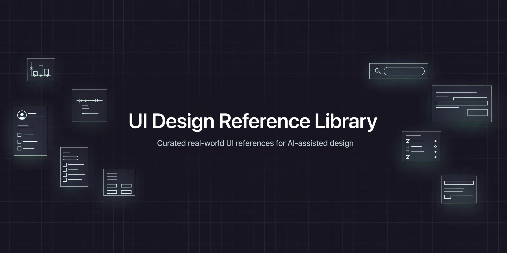

# UI Design Reference Library

[](https://github.com/mianadilofficial/ui-design-reference-library/stargazers)
[](LICENSE)
[](https://github.com/mianadilofficial/ui-design-reference-library/commits/main)
[](CONTRIBUTING.md)
[](INDEX.md)



A curated, agent-ready library of real-world UI/UX references — design skills, component libraries, patterns and interaction examples — organized so any AI agent (or human) can study the right reference and build clean, non-generic interfaces grounded in proven work.

> **Status:** Growing — new references are reviewed and added regularly. See [INDEX.md](INDEX.md) for the full catalog.

## Why this exists

AI-generated UI too often looks the same: generic gradients, predictable layouts, template energy. This library fixes that at the source — instead of designing from nothing, agents pick relevant real-world references first and build from them. Every entry is a real public repository with its original author, license and link preserved.

## What's inside

| Reference | Category | Stack | License | What it gives you |
|---|---|---|---|---|
| [ui-ux-pro-max-skill](references/ui-ux-pro-max-skill) | Design skill | Agnostic | MIT | 79 UI styles, 192 palettes, 74 font pairings, anti-patterns |
| [impeccable](references/impeccable) | Design skill | Agnostic | Apache-2.0 | 24 commands + 59 detector rules against AI-design tells |
| [emilkowalski-skills](references/emilkowalski-skills) | Design skill | Agnostic | MIT | 15 elite UI/animation skills (ex-Vercel/Linear) |
| [diagram-design](references/diagram-design) | Design skill | Agnostic | MIT | Brand-styled HTML+SVG diagrams, 44 types |
| [ux-ui-agent-skills](references/ux-ui-agent-skills) | Design skill | Agnostic | MIT | 138 design systems, 52 specs, a11y gates |
| [taste-skill](references/taste-skill) | Design skill | Agnostic | MIT | Anti-slop frontend taste: layout, type, motion |
| [inspira-ui](references/inspira-ui) | Components | Vue / Nuxt | MIT | Animated copy-paste components: backgrounds, text effects, grids |
| [animate-ui](references/animate-ui) | Components | React / Tailwind | MIT + Commons Clause | Hand-crafted animated components and micro-interactions |
| [audiocn-ui](references/audiocn-ui) | Components | React | MIT | Audio UI: meters, visualizers, faders, knobs, mixer |
| [arc-library](references/arc-library) | Components | React | MIT | Calm-motion components + blocks (shadcn CLI) |
| [generativecharts](references/generativecharts) | Components | React | MIT | Accessible charts, 18 families, themed |
| [shadcn-ui](references/shadcn-ui) | Components | React | MIT | The canonical shadcn collection (Radix + Tailwind) |
| [magicui](references/magicui) | Components | React | MIT | Landing-page motion: beams, marquee, bento, shine |
| [lenis](references/lenis) | Motion | Agnostic (JS) | MIT | Buttery-smooth scroll — premium scroll-driven experiences |

Full details in **[INDEX.md](INDEX.md)**.

## How to use

**For AI agents** — read [AGENTS.md](AGENTS.md) first. It defines how to select the right reference for a task, which design decisions to ground in it, and the quality bar every build must pass.

**For humans** — browse `references/`, open any folder's `ATTRIBUTION.md` for the original source, and explore the live demos linked from each project's own README.

```
Give an agent this repo link + your task.
The agent studies the relevant references, then builds —
no generic AI-looking output, no template cloning.
```

## Categories

References are organized by what they're useful for:

- **Design skills** — reasoning systems, style taxonomies, palettes, typography
- **Components** — copy-paste UI components (buttons, cards, backgrounds, effects)
- **Patterns** — landing pages, dashboards, portfolios *(coming)*
- **Motion** — animation and interaction examples
- **Project structure** — clean full-stack project scaffolds *(coming)* — so agents build organized codebases, not random-file messes

## Contributing

Found a reference worth adding? See [CONTRIBUTING.md](CONTRIBUTING.md). Every addition needs a compatible license, full attribution and a clean secret scan — the checklist is in the guide.

## License & attribution

- This repository's own curation (README, guides, index, attribution files) is under the [MIT License](LICENSE).
- Every mirrored project in `references/` keeps its **original license and author** — check each folder's `ATTRIBUTION.md` before reusing code.

## Acknowledgments

All design work referenced here belongs to its original authors. This library exists to point at great work, not to claim it — if you build something from these references, credit the source.

---

### Built & curated by Mian Adil

I'm Mian Adil, an Applied AI Engineer building web platforms, SEO systems and AI automation for international clients.

- Portfolio: [mianadil.site](https://mianadil.site)
- GitHub: [@mianadilofficial](https://github.com/mianadilofficial)

*If this library helped you, a ⭐ is the best thanks.*
